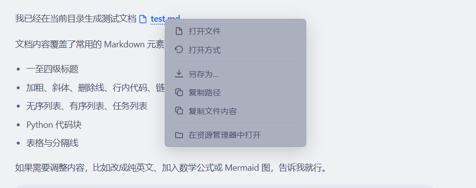

# dsh-auto-click

File gestures for the **DSH Web GUI** sidebar: click to preview, `Ctrl`+click to
open natively, right-click for a file menu.

[DSH (DeepSeek Harness)](https://github.com/deepseek-ai) 侧边栏文件的鼠标手势插件：
左键在侧边栏预览、`Ctrl`+左键用系统默认应用打开、右键弹出文件菜单。

| 操作 | 结果 |
|---|---|
| 左键单击 | 在侧边栏打开文件预览（宿主原有行为，插件不干预） |
| `Ctrl` + 左键单击 | 用系统的**默认应用**打开；没有默认应用时弹出"打开方式" |
| 右键单击文件 | 弹出文件菜单 |
| 右键单击普通链接 | 弹出"复制链接"菜单 |

菜单项（文件）：

1. **打开文件** — 用系统默认应用打开
2. **打开方式** — 调用**操作系统自带**的"打开方式"选择框
3. **另存为…** — 通过浏览器下载保存副本
4. **复制路径** — 复制**绝对路径**
5. **复制文件内容** — 复制文件文本内容
6. **在资源管理器中打开** — 在文件管理器中定位该文件

菜单项（普通链接）：

1. **复制链接** — 复制 `href` 原文（相对路径也照原样复制，不补站点前缀）

成功操作**不弹提示**（复制路径本身就是反馈），只有失败或被拒绝时才提示。

## 环境要求

- DSH `>= 0.2.0-rc.1 < 0.3.0-0`
- 支持的操作系统：Windows（完整支持）、macOS（`打开方式` 走 `open -a`）、
  其他平台可用但"打开方式"会明确报告不支持

## 效果展示

在聊天中的文件链接上右键：



## 安装

从 npm 安装。**桌面版和 `dsh web` 是两个独立的 profile，装在一个里不会出现在另一个里**，
按你使用的方式选择对应命令。

### 桌面版（DSH Desktop）

```bash
dsh plugin --profile desktop add dsh-auto-click
```

### 终端 `dsh web`

```bash
dsh plugin --profile web add dsh-auto-click
```

装完后重启对应的进程（桌面版重启应用，`dsh web` 重启该命令）。

> `dsh plugin` 的参数会原样透传给 pnpm，所以 `<spec>` 可以是 pnpm 接受的任何形式：
> 包名、`包名@版本` 或 git 地址。命令动词用 `add`。

### 从 GitHub 安装

不经过 npm，直接从仓库安装：

```bash
dsh plugin --profile desktop add github:Analoty/dsh-auto-click
```

本包是纯 JavaScript，没有 `prepare` 构建步骤，因此从 git 直装不会被 pnpm 的
`allowBuilds` 策略拦下。

### 卸载

```bash
dsh plugin --profile desktop remove dsh-auto-click
dsh plugin --profile web     remove dsh-auto-click
```

## 结构

```
index.js            Host 半：HTTP 路由与系统调用
client.js           Client 半：事件监听与菜单渲染
cordis.patch.yml    bundle 插入声明
locale/*.json       中英文文案与元信息
icon.svg            插件图标
```

Host 半提供 `/auto-click/{capabilities,diag,info,open,openwith,reveal,raw}`，
全部经过 DSH 自己的请求信任栅栏（`connection.requestRejection`），未认证或
跨源请求在到达业务逻辑前就被拒绝。

打开文件走 DSH 的 `sessionController.openWorkspacePath`，因此继承宿主的路径校验，
插件不会绕过它自己启动程序。

## 路径解析

文件可能由左侧文件树、DSH 文件面板或聊天中的文件链接命名。聊天链接和树节点
携带的是**工作区相对路径**，所以浏览器半会把当前会话 id 一并发送，由 Host 在
该会话的工作区内解析。

工作区根目录的读取是**特性探测**的，不是版本判断：投影的 `workingDirectory` 优先
（它跟随工作目录的变更），该投影缺失时退回同一观测租约上的 `header.cwd`，再退到
会话列表的 `cwd`。

**没有已知工作区时，相对路径会被拒绝**，而不是拿进程目录去猜——否则可能复制或
打开一个同名的、用户根本没指过的文件。

聊天中的文件提及（mention）语法形如 `@"带 空格 的 名字.md"`，`@` 和引号是提及
语法的标点而非文件名的一部分，解析前会剥离。

## 为什么"打开方式"交给操作系统

插件**不维护自己的应用列表**。早期版本会列出某格式的可用程序，结果两个方向都错：

- 给 `.md` 列出了 Acrobat、ImageGlass 等根本不支持 Markdown 的程序——因为 DSH
  的枚举器返回"所有曾声称支持该类型的处理器"；
- 曾把 `.html` 的列表**清空**——因为过滤规则拿处理器的 id 去匹配扩展名，而
  `.html` 的 ProgId 是 `htmlfile`、`ChromeHTML`、`MSEdgeHTM`，没有一个含 `.html`。

没有任何插件能比操作系统更清楚"哪个程序能打开哪种格式"，所以这个菜单项把问题
交还系统：

| 平台 | 调用方式 |
|---|---|
| Windows | Shell COM：`Shell.Application` → `Item.InvokeVerb('openas')` |
| macOS | `open -a <path>` |

### Windows 上踩过的两个坑

两个坑都是靠**真的去数窗口**发现的，仅看退出码全部"成功"。

1. **`rundll32.exe shell32.dll,OpenAs_RunDLL` 无效。** 这是网上最常见的答案，
   但它退出码 `0` 且不显示任何东西——`.pdf`、`.md`、`.html`、`.png`、`.txt`
   全部如此。插件因此"成功地"什么都没做。
2. **子进程不能 detach 或隐藏。** 用 `detached: true` 或 `windowsHide: true`
   启动 PowerShell 同样退出 `0` 且无对话框：脱离后的进程不再附着于拥有 Shell
   窗口的交互式桌面，`InvokeVerb` 会静默失败。

文件路径通过**环境变量**传给 PowerShell，不拼接进命令行，因此文件名包含引号、
`&`、`$(…)` 等字符时也无法改变实际执行的命令。

## 限制

- "复制文件内容"和"另存为"拒绝大于 **8 MiB** 的文件，而不是截断。
- 在没有交互式桌面的会话中（如某些远程或服务模式），"打开方式"仍无法弹出对话框。

## 许可

[MIT](./LICENSE)